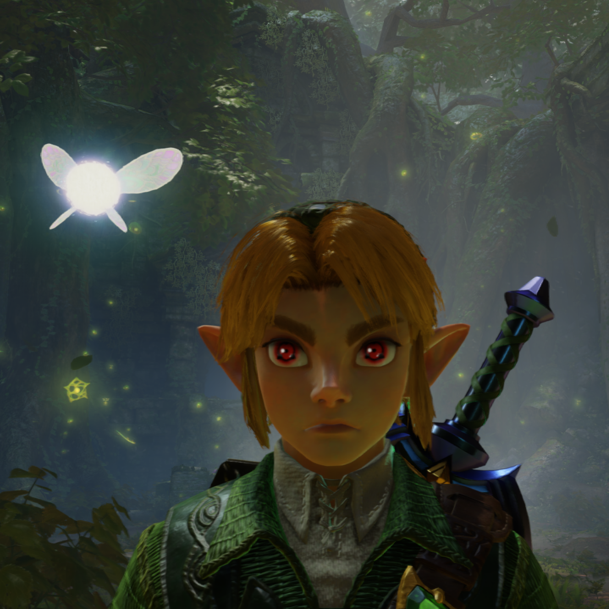
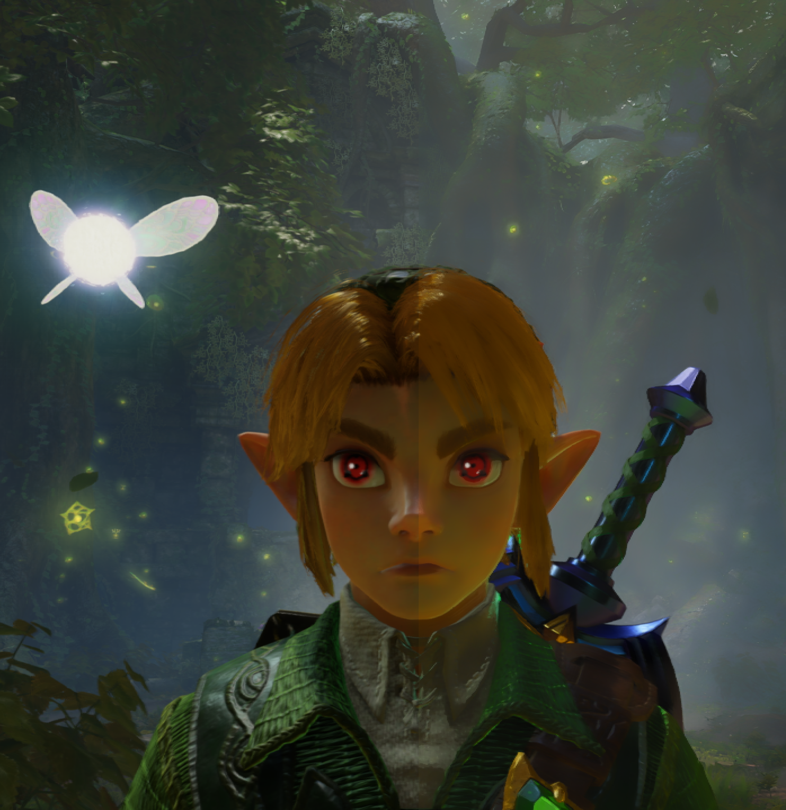
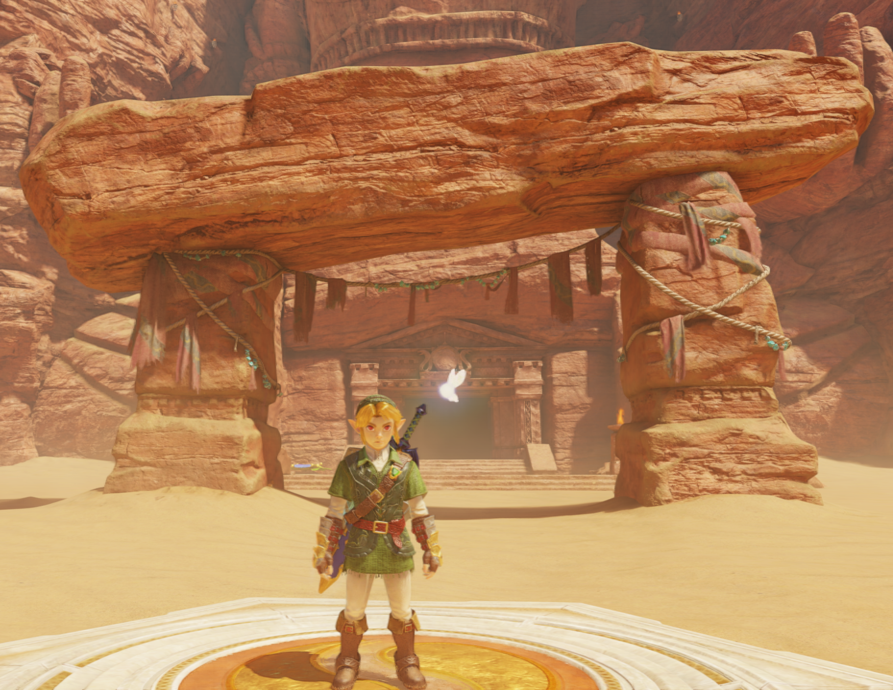
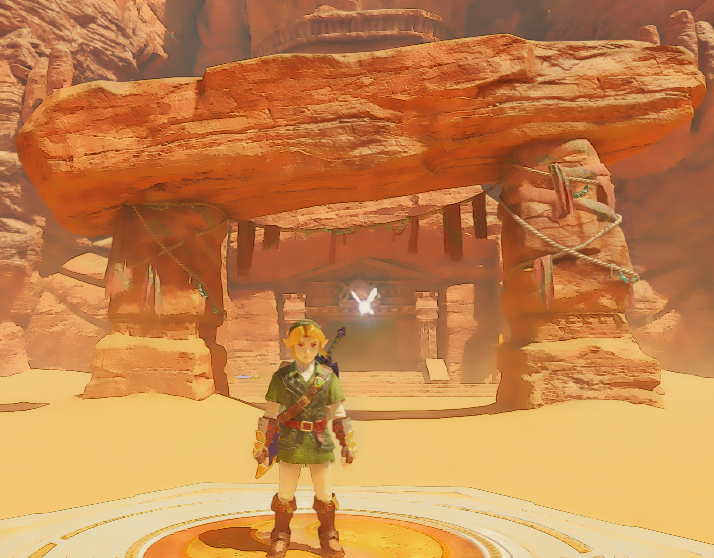
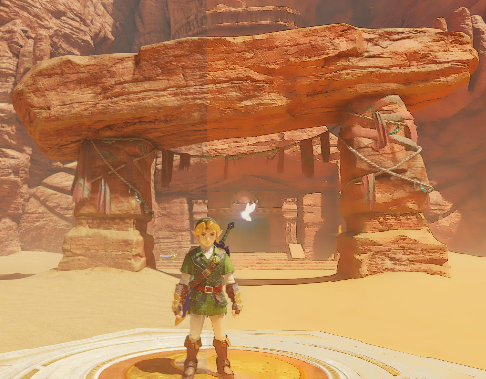

# Fantasy Restored

A configurable ReShade shader for an anime/fantasy atmosphere: fresh colors, golden lighting, soft blue shadows, softened textures, subtle cel shading, fine outlines, and fairy-like glow. The default settings are moderate but visible.

## Screenshots

Examples of visual transformation achieved with **Fantasy Restored** :

### Before & After — Comparison 1

| Before | After | Side-by-side Comparaison
|:------:|:-----:|:-----:|
|  |  | 

### Before & After — Comparison 2

| Before | After | Side-by-side Comparaison
|:------:|:-----:|:-----:|
|  |  | 

## Installation

1. Copy `Shaders/FantasyRestored.fx` into the shader folder used by ReShade (usually `reshade-shaders/Shaders`).
2. Reload the effects and enable **Fantasy Restored**. Enable **Fantasy Restored - Depth of Field** separately if you want DoF, and place it after the main technique in the effect order.
4. Start in SDR. The input must be a normalized 0–1 image after tone mapping; the output is clamped to 0–1. This version is not a native HDR/scRGB/PQ shader.

## Techniques and render order

### Fantasy Restored

ReShade lists this technique internally as `FantasyRestored`. It can run with the color buffer alone. Depth is optional for atmospheric haze and depth-assisted contours.

1. **Paint** builds an edge-aware painted image at full resolution. With *Animation background brush* enabled, a variance-weighted directional filter groups fine texture into larger shapes while retaining strong detail. The older painterly path includes bilateral smoothing and optional Kuwahara filtering.
2. **Extract → BlurH → BlurV** extracts bright areas and applies separable half-resolution bloom.
3. **NativeLightSeed → NativeLightH → NativeLightV** builds a soft mask at one-eighth resolution per axis from locally bright regions in the original input. *Preserve game light effects* blends the original image back around detected halos, such as the sword glow, so their gradients can survive the cel shading, ink, and added bloom.
4. **Composite** combines the painted image, color grading, luminance bands, optional depth haze and ink, bloom, highlight restraint, and the light-preservation mask. It also applies the master blend, split comparison, and optional HUD rectangles.

### Fantasy Restored - Depth of Field

ReShade lists this technique internally as `FantasyRestoredDoF`. It can also run by itself. It requires a valid ReShade depth buffer and works independently of the main technique's `UseDepth` setting.

1. **Focus** resolves manual focus or the median of five depth samples around the autofocus point.
2. **Prepare** reduces color and depth to half resolution while favoring the nearest surface at depth transitions.
3. **FarBlur → NearBlur** filters background and foreground separately using disk samples and depth rejection.
4. **Resolve** composites at full resolution with depth-guided background reconstruction and premultiplied foreground coverage.

The reference preset uses manual focus at normalized linear depth `0.300`, with a relative sharp range of `0.040`, far blur enabled, near blur disabled, and the Balanced quality setting. Use **Show focus zones** to tune focus. Green indicates the sharp region, red the near blur region, and blue the far blur region. Manual depth depends on ReShade's linearization and far-plane settings. Autofocus is evaluated each frame around the selected screen point and can shift when a different surface crosses it.

The Fast, Balanced, and High modes use up to 12, 24, or 40 disk samples per active blur layer. *Depth edge tolerance* controls how readily neighboring depth layers can contribute to the blur. If you disable DoF while using depth contours, turn off **Suppress depth contours in DoF blur** (`DoFProtectDepthContours`) to restore ink in the former blur zones.

## ReShade controls

- **01 Overall** — *Master strength* blends the main technique with its input. DoF has its own strength control.
- **02 Fantasy palette** — exposure, selective shadow and highlight controls, saturation, warmth, and cool tones. *Preserve game palette* anchors hue and chroma to the source image. *Game palette vibrance* applies within that mode, and *Highlight restraint* rolls off high luminance and limits extra chroma on intense colors.
- **03 Painterly** — choose the animation brush or the legacy painterly filters. *Animation brush radius* sets the sampling footprint, and *Painted color shapes* controls how strongly the animation brush groups textures into broader tonal shapes.
- **04 Cel shading** — *Cel blend*, *Luminance bands*, and transition softness shape the rendered luminance. With the animation brush active, *Protect smooth surfaces* reduces banding on skies, fog, and smooth terrain using the brush's texture signal.
- **05 Contours** — the `Ink` switch enables color contours and any configured depth contribution. *Graphic silhouette ink* strengthens continuous edges on their shaded side. *Suppress terrain seams* checks for a visible color boundary before reinforcing a depth edge.
- **06 Optional depth** — depth-assisted outlines and atmospheric haze. The reference preset has `UseDepth=1` for haze even with ink disabled. Check ReShade's depth selection, orientation, and linearization before using these effects. Haze distances are normalized depth values.
- **07 Fairy glow** — bloom strength, threshold, knee, radius, and tint, plus *Preserve game light effects*. The protection and added bloom have independent controls.
- **08 Finish** — sharpening, vignette, and optional static grain.
- **98 Depth of Field** — focus, blur range, separate near/far settings, quality, depth-edge tolerance, focus visualization, and independent HUD protection.
- **99 Comparison and masks** — adjustable split comparison and two manually positioned HUD rectangles. Feathering blends the rectangle boundaries, and the main technique and DoF can use the rectangles independently. With both techniques active, the left side of the split bypasses both in normal display mode.

Spatial radii expressed in pixels are referenced to 1080p and scale with image height. HUD rectangles use normalized coordinates in left, top, right, bottom order.

## Practical limits

The shader works from the finished color buffer and, when available, the depth buffer. Cel shading approximates lighting with luminance bands. Painterly filtering can smooth small texture detail, and contours respond to visible contrast and depth rather than object identity. The shader has no access to material IDs, surface normals, or hidden geometry. Highlight restraint can preserve available tonal separation in SDR, while already clipped source detail is unavailable. Light preservation uses an image-based estimate, so coverage varies with the size, brightness, and contrast of the original effect.

DoF uses no temporal history or motion vectors. Transparent hair, particles, and HUD elements can still bleed across depth boundaries, including around manually masked rectangles. The three half-resolution DoF buffers use about 42.2 MiB at 5120 × 1440, excluding the main technique's buffers and ReShade's own resources. See `V5.4_VALIDATION_FR.md` for the Direct3D 11 bench tests on still captures and synthetic depth. Live depth selection and motion behavior depend on the game.

## License

FantasyRestored.fx: MIT (see `LICENSE`).
