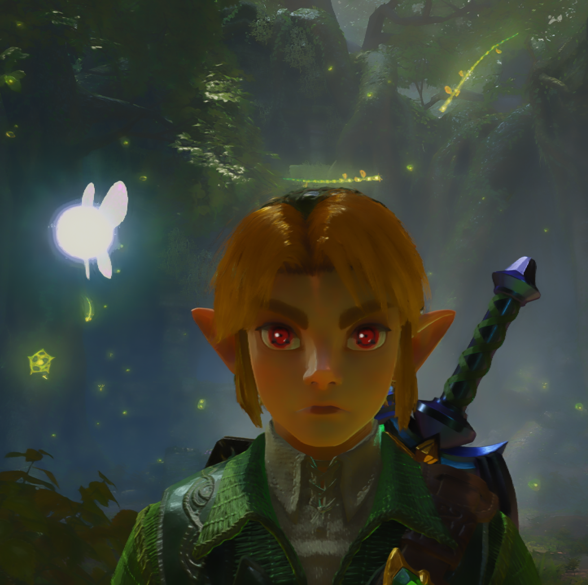

# Fantasy Restored

A configurable ReShade shader for an anime/fantasy atmosphere: fresh colors, golden lighting, soft blue shadows, softened textures, subtle cel shading, fine outlines, and fairy-like glow. The default settings are moderate but visible.

## Screenshots

Examples of visual transformation achieved with **Fantasy Restored** :

### Before & After — Comparison 1

| Before | After | Side-by-side Comparaison
|:------:|:-----:|:-----:|
|  |  | 

### Before & After — Comparison 2

| Before | After | Side-by-side Comparaison
|:------:|:-----:|:-----:|
|  |  | 

## Installation

1. Copy `Shaders/FantasyRestored.fx` into the shader folder used by ReShade (usually `reshade-shaders/Shaders`).
2. Reload the effects and enable **Fantasy Restored**. Enable **Fantasy Restored - Depth of Field** separately if you want DoF, and place it after the main technique in the effect order.
4. Start in SDR. The input must be a normalized 0–1 image after tone mapping; the output is clamped to 0–1. This version is not a native HDR/scRGB/PQ shader.

## Interface sections

- **01 Overall**: final effect intensity through *Master strength*. At 0, the original image is restored for the main color technique. DoF has its own strength control.
- **02 Fantasy palette**: exposure in stops, lifted shadows, contrast, saturation, vibrance, warm highlights, cool shadows, fresh greens, and approximate skin-tone protection. This protection is color-based, not face recognition.
- **03 Painterly**: edge-preserving spatial smoothing. *Brush radius* increases the brush-like footprint; *Edge preservation* preserves color boundaries; *Paint blend* controls the blend. *Fine detail recovery* retains some original detail. This is not neural painting or a Kuwahara filter.
- **04 Cel shading**: luminance simplification with adjustable transitions. Increase *Cel blend* and reduce *Luminance bands* for a stronger animated look. This approximates the effect on the final image rather than changing the engine's lighting.
- **05 Contours**: outline strength, width, threshold, softness, and color. Without depth, outlines use luminance and may also emphasize textures. A higher threshold reduces this behavior.
- **06 Optional depth**: depth outlines and atmospheric haze, disabled by default. Check depth using DisplayDepth before enabling them: orientation, reversal, scaling, and the far plane must be correct in ReShade. *Haze start/end* use normalized depth, not meters. If End <= Start, a small minimum range prevents a degenerate division.
- **07 Fairy glow**: soft half-resolution bloom. The threshold selects bright areas, the knee softens the transition, the radius spreads the halo, and the tint colors it. The shader does not add fireflies or light sources that are absent from the scene.
- **08 Finish**: sharpening, vignette, and optional static grain. Grain defaults to zero; no effect relies on noise that changes every frame.
- **09 Depth of Field**: near and far blur with automatic or manual focus, adjustable focus range, separate near/far transitions and radii, quality settings, depth-edge tolerance, a focus debug view, and optional HUD-mask protection. This section appears above Split comparison. DoF requires a valid depth buffer and its separate technique to be enabled. It does not require the *Use depth* option from section 06, which controls depth outlines and haze.
- **10 Comparison and masks**: original image on the left and processed image on the right, a movable split, and two adjustable HUD-protection rectangles in normalized coordinates (left, top, right, bottom). These are manual masks, not automatic HUD separation. Feathering avoids hard seams.

Pixel radii are referenced to 1080p and scale with image height, keeping consistent proportions in 16:9 and 32:9. Sections can be adjusted independently; right-click a setting in ReShade to restore its default.

## Depth of field (DoF)

### Activation and focus

Enable **Fantasy Restored - Depth of Field** separately and place it **after Fantasy Restored**. Both techniques are in the same `.fx` file; DoF can also run on its own. Its controls appear in **09 Depth of Field**, above **10 Comparison and masks** and Split comparison.

A valid depth buffer is required. You do not need to enable **Use depth for contours and atmospheric haze**: that option is independent of DoF.

1. Enable **Show focus zones**: green = sharp, red = near blur, blue = far blur.
2. With **Auto focus** enabled, move **Auto focus point (X,Y)** onto the subject you want to keep sharp. `(0.5,0.5)` is the center; for a character, aim at their body rather than the background behind them.
3. Adjust **Sharp focus range**, then disable the debug view. A larger range keeps more depth around the subject sharp.
4. Adjust **DoF strength** and **Near/Far blur radius**. For background blur only, disable near blur (`DoFNear=0`); for foreground blur only, disable far blur (`DoFFar=0`).

### Main controls

- **Auto focus / Manual focus depth**: autofocus uses the median of five depth samples around the chosen point, without temporal tracking. Focus may change abruptly if another object crosses this point. For a stable shot, disable it and adjust manual depth using the debug view. Manual depth is linearized and normalized; it depends on the far plane and is not measured in meters.
- **Sharp focus range**: relative tolerance around the focus depth, defaulting to 0.20 (approximately +/-20%).
- **Near/Far blur transition**: relative distance beyond the sharp range required to reach maximum blur. Larger values produce a more gradual transition.
- **Near/Far blur radius**: blur extent, referenced to 1080p and scaled with image height.
- **Quality**: 0 = Fast (12 samples per layer), 1 = Balanced (24), 2 = High (40). Start with Balanced; High helps with larger radii.
- **Depth edge tolerance**: lower values protect boundaries more strongly but may leave a sharp fringe; higher values spread blur more freely but can introduce halos.
- **Protect HUD rectangles from DoF**: protects the two rectangles from section 10 independently of the color filter's mask. HUD pixels may still bleed outside the rectangles because the shader has no HUD-free scene image.

### Performance and limitations

DoF adds five passes: 1x1 focus, half-resolution color/depth preparation, far blur, near blur, and full-resolution composition. Its textures add approximately **42.2 MiB at 5120×1440**. Uncheck its technique to skip its processing; allocations may remain present. No specific FPS cost or gain is guaranteed.

Background and foreground are filtered separately; background reconstruction is depth-guided, and foreground colors are premultiplied to reduce dark fringes. The shader performs no CPU depth readback, maintains no temporal history, and generates no jitter.

This post-process cannot reconstruct hidden surfaces. Transparent hair, particles, silhouettes, and HUD elements may produce halos or fringes even with valid depth. Avoid extreme radii. With Turkey, prefer applying it to real frames before FrameGen and calculating motion vectors before DoF, when the pipeline permits it.

## Starting settings

**Subtle fantasy (default)**: Master 0.75, Paint blend 0.22, Cel blend 0.14, Contour strength 0.12, and Glow strength 0.10. Bloom depends on the highlights already present in the game.

**Stronger anime look**: Master 0.90, Paint blend 0.40, Brush radius 2.0, Cel blend 0.35, Luminance bands 6, and Contour strength 0.25. Check hair, fences, and foliage in motion: excessive simplification can make small details shimmer.

**Enchanted forest**: Warm light 0.25, Cool shadows 0.22, Fresh greens 0.35, and Glow strength 0.18. Raise the bloom threshold if the whole image becomes washed out. Enable haze only with valid depth.

**Preserve faces**: Skin protection 0.8, Paint blend <= 0.30, and Cel blend <= 0.20. Skin-tone detection is an estimate and may also protect similarly colored stone or fabric.

## License

FantasyRestored.fx: MIT (see `LICENSE.txt`).
